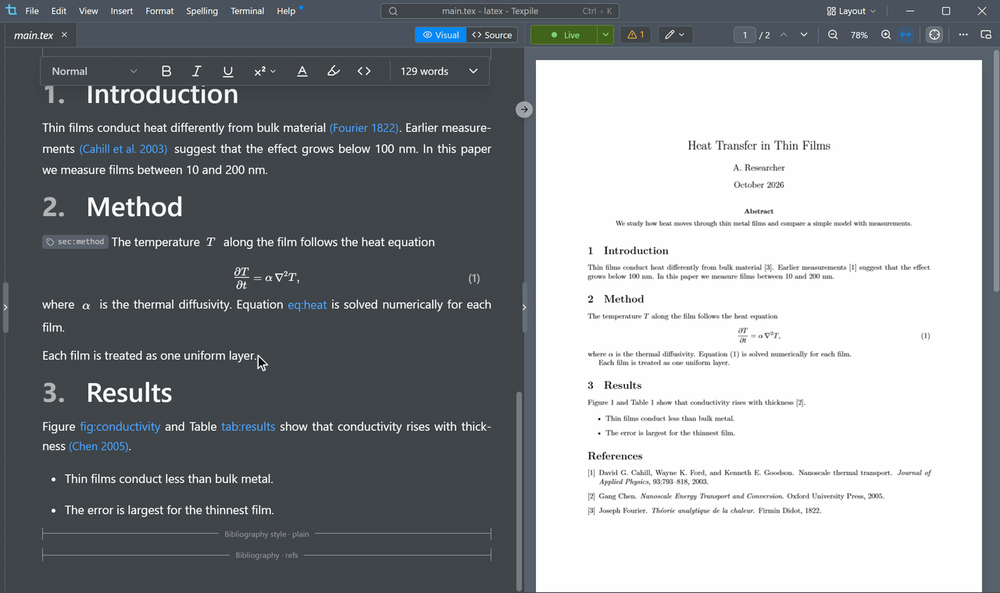
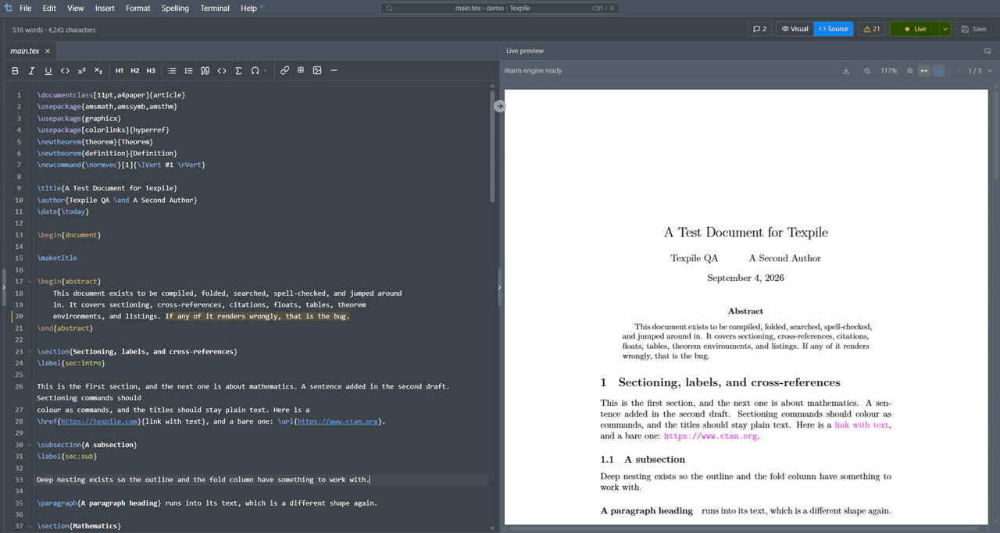

<picture>
  <source media="(prefers-color-scheme: dark)" srcset="branding/Logo-light.svg" />
  
</picture>

&nbsp;

A modern, desktop editor for LaTeX, Typst, and Markdown. For Windows, macOS, and Linux. Edit visually, or in source with advanced intellisense. 100% offline, no account.

---

## Why Texpile

### Visual editor

Texpile has the most complete visual editor coverage for LaTeX and Typst.

- Supports custom macros, multiline equations, commands, cell-merging tables and images.
- Uses Knuth-Plass line breaking.
- Opens .tex, .typ and .md files directly and stores them in those file formats.

<table>
  <tr>
    <th>Visual</th>
    <th>Source</th>
  </tr>
  <tr>
    <td></td>
    <td></td>
  </tr>
</table>

### IntelliSense

- Texpile's LaTeX IntelliSense data covers ~95% of the LaTeX packages on CTAN (over 5,700 packages and 680 classes), and can suggest and detect certain errors instantly.
- It is project aware: it parses LaTeX aux files and covers refactoring, custom macro detection and more.
- For Typst, Texpile uses tinymist for IntelliSense.

### Live preview

- Texpile hooks onto your LuaLaTeX engine directly and can often render LaTeX document changes in under 40ms.
- Texpile supports Typst's instant live preview.

### Shared sessions (real time collaboration)

Texpile supports real time collaboration (like VS Code Live Share), tuned specifically for LaTeX and Typst workflows, with end to end encryption. No account is needed. Start a session from File › Shared Session.

### Comments and suggestions

You can add visual comments and suggestions in Texpile, like in a word processor.

> [!NOTE]
> This list covers what sets Texpile apart from other LaTeX and Typst editors. See [texpile.com](https://texpile.com) for every feature, including AI integrations.

## Installation

Download the installer for your platform from [texpile.com/download](https://texpile.com/download), then install a compiler for the format you write in:

- [LaTeX](https://texpile.com/docs/installation/latex) — a TeX distribution: TeX Live, MacTeX, or MiKTeX
- [Typst](https://texpile.com/docs/installation/typst) — one program, tinymist, which Texpile can install for you in one click (Preferences › Toolchain)

Editing works out of the box; the compiler is only needed to produce a PDF. Markdown needs neither.

## Privacy

Texpile works fully offline. Its only connections to Texpile are the update check and real time collaboration, which is end to end encrypted. Texpile physically cannot see your documents, even if we wanted to.

You can also self host your own real time collaboration relay.

## Community

Questions or feedback? Join the [Discord](https://discord.com/invite/7wanVzCBWf). Found a bug? [Open an issue](https://github.com/texpile/texpile/issues/new/choose).

For security issues, please email [support@texpile.com](mailto:support@texpile.com) directly.

## Contributing

Texpile would not be possible without our contributors and sponsors. See [CONTRIBUTING.md](CONTRIBUTING.md). To help translate the app, see [Translation.md](Translation.md).

## Acknowledgements

Texpile builds on pdf.js, Typst, tinymist and others; see [ACKNOWLEDGEMENTS.md](ACKNOWLEDGEMENTS.md).

## License

[AGPL-3.0](LICENSE)

The Texpile name and logo are trademarks of the Texpile project and are not covered by the code
license; see [TRADEMARK.md](TRADEMARK.md).

We also ask that unofficial Texpile builds do not use our hosted relay at collab.texpile.com for real time collaboration.
