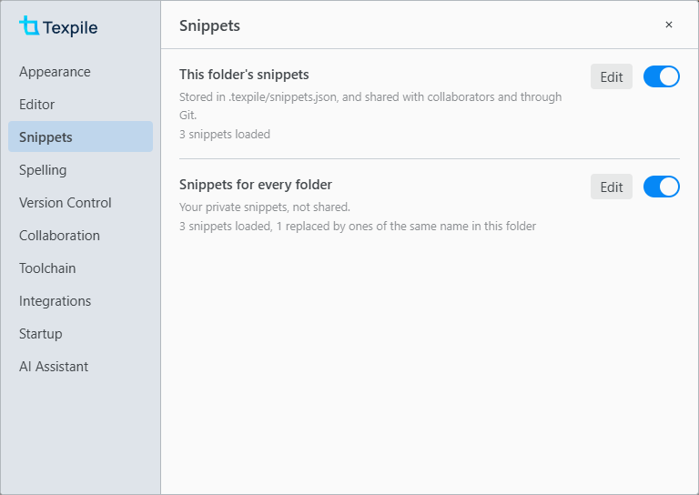

# Snippets

Type at the speed of light (almost).

A snippet is a macro that automatically fills in text based on a trigger. For instance, you can type `dint` and Texpile will automatically fill in `\int_{0}^{1} \, \mathrm{d}x`, or however it is defined. Snippets work in the source editor, and only in the equations in the visual editor.

> [!WARNING]
> Prerequisite: JSON knowledge.

| Where to find it          | Path                                                                      | Note                                                |
| ------------------------- | ------------------------------------------------------------------------- | --------------------------------------------------- |
| This folder's snippets    | Command palette › Edit Project Snippets, or Preferences › Snippets › Edit | Opens `.texpile/snippets.json`, created if missing. |
| Snippets for every folder | Command palette › Edit Global Snippets, or Preferences › Snippets › Edit  | Opens `snippets.json` in Texpile's own data folder. |

Folder snippets are stored in the `.texpile` folder and are shared with collaborators through Git and real-time collaboration. Global snippets store your own snippets, which are not shared with anyone. If there are conflicts, Texpile follows the order of folder > global > built-in snippets. If you are a guest, you can turn off snippets via Preferences › Snippets.



## An example of a snippet file

```json
{
	"v": 1,
	"snippets": {
		"name of the snippet": {
			"prefix": "dint",
			"context": "math",
			"auto": true,
			"body": {
				"latex": "\\int_{${1:0}}^{${2:1}} $3 \\, \\mathrm{d}${4:x}$0",
				"typst": "integral_(${1:0})^(${2:1}) $3 dif ${4:x}$0"
			}
		}
	}
}
```

Texpile extends upon VS Code's snippet system and is compatible with VS Code's snippets.

### The file

| Field       | Type                                                                                   | Default | Description                                                                                                             |
| ----------- | -------------------------------------------------------------------------------------- | ------- | ----------------------------------------------------------------------------------------------------------------------- |
| `v`         | `1`                                                                                    | `1`     | The file version.                                                                                                       |
| `snippets`  | `{ "snippet name": snippet }`                                                          | none    | Required. Every [snippet](#a-snippet), under its name. The popup and the math search show each snippet by its name.     |
| `variables` | `{ "NAME": string }`, or one string per language as `{ "latex", "typst", "markdown" }` | none    | Lists for `${NAME}` in regex triggers, written as alternatives such as `"a\|b"`. See [Regex triggers](#regex-triggers). |

A file from VS Code, with its snippets at the top level and no `snippets` field, works as it is. Comments and trailing commas are allowed.

### A snippet

One item in `snippets`.

| Field         | Type                                                                     | Default                        | Description                                                                                                                                      |
| ------------- | ------------------------------------------------------------------------ | ------------------------------ | ------------------------------------------------------------------------------------------------------------------------------------------------ |
| `prefix`      | string or string[]                                                       | none                           | The trigger. Required, unless the entry has a `key`.                                                                                             |
| `body`        | string, or `{ "latex", "typst", "markdown" }`                            | none                           | The text inserted, one for every language or one per language. With a math `context`, Markdown uses the `latex` body when `markdown` is missing. |
| `description` | string                                                                   | none                           | Shown beside the popup.                                                                                                                          |
| `scope`       | `"latex"`, `"typst"`, `"markdown"`, or several joined with commas        | all three                      | The languages the snippet works in.                                                                                                              |
| `context`     | `"math"`, `"inline-math"`, `"display-math"`, `"text"`, `"code"`, `"any"` | `"any"`                        | Where the trigger fires. `code` is Typst only, inside `#{ }`.                                                                                    |
| `auto`        | boolean                                                                  | `false`                        | `true` expands as soon as you type the trigger. `false` waits in the popup for Enter.                                                            |
| `word`        | boolean                                                                  | `false`, `true` for Typst auto | Fires only at the start of a word.                                                                                                               |
| `regex`       | boolean                                                                  | `false`                        | Reads the prefix as a regular expression. See [Regex triggers](#regex-triggers).                                                                 |
| `flags`       | string of `i`, `u`                                                       | `""`                           | Regular expression flags.                                                                                                                        |
| `priority`    | number                                                                   | `0`                            | When several snippets match, the higher one wins.                                                                                                |
| `key`         | string, such as `"Mod-Shift-o"`                                          | none                           | A keyboard shortcut that runs the snippet in the source editor. `Mod` is Ctrl, or Cmd on macOS.                                                  |
| `disabled`    | boolean                                                                  | `false`                        | `true` turns off the global or built-in snippet of the same name.                                                                                |

### Syntax and variables

Every rule and variable Texpile reads. All of them go in a snippet's `body`, except the one marked for a regex `prefix`.

| Syntax                          | Result                                                                                                                                                             |
| ------------------------------- | ------------------------------------------------------------------------------------------------------------------------------------------------------------------ |
| `$1`, `$2`                      | Places Tab moves through, in order. The same number twice is one place: it starts with the first default given for it, and what you type goes into every copy.     |
| `${1:text}`                     | A place that starts with `text` selected.                                                                                                                          |
| `$0`                            | Where the cursor ends. The end of the body by default.                                                                                                             |
| `${1\|one,two\|}`               | A place with a list to pick from.                                                                                                                                  |
| `${1:outer ${2:inner}}`         | A place inside a place. Tab visits the outer one, then the inner one. Typing over the outer one removes the inner one.                                             |
| `${1/regex/format/flags}`       | A copy of place 1, changed when Tab leaves the place: `regex` is matched against it and replaced with `format`. `flags` are regular expression flags, such as `g`. |
| `$1`, `${1}` in a `format`      | What group 1 of `regex` matched.                                                                                                                                   |
| `${1:/upcase}` in a `format`    | Group 1 changed. `/upcase`, `/downcase`, `/capitalize`, `/camelcase`, `/pascalcase`, `/snakecase` and `/kebabcase`.                                                |
| `${1:+yes}` in a `format`       | `yes` when group 1 matched.                                                                                                                                        |
| `${1:-no}` in a `format`        | `no` when group 1 matched nothing.                                                                                                                                 |
| `${1:?yes:no}` in a `format`    | `yes` when group 1 matched, `no` otherwise.                                                                                                                        |
| `$NAME`, `${NAME}`              | The value of the variable NAME, from the list below.                                                                                                               |
| `${NAME:text}`                  | The value of NAME, or `text` when it is empty.                                                                                                                     |
| `${NAME/regex/format/flags}`    | The value of NAME, changed as for a place.                                                                                                                         |
| `$other`                        | Any name that is not a variable becomes a place holding the name.                                                                                                  |
| `TM_SELECTED_TEXT`, `SELECTION` | The selected text when the snippet runs from its `key`, with its own indentation. With several selections, each one gets its own copy.                             |
| `TM_CURRENT_LINE`               | The text of the line the cursor is on.                                                                                                                             |
| `TM_CURRENT_WORD`               | The word at the cursor.                                                                                                                                            |
| `TM_LINE_INDEX`                 | The line number, counted from 0.                                                                                                                                   |
| `TM_LINE_NUMBER`                | The line number, counted from 1.                                                                                                                                   |
| `CURSOR_INDEX`                  | With several cursors, which one this is, counted from 0.                                                                                                           |
| `CURSOR_NUMBER`                 | With several cursors, which one this is, counted from 1.                                                                                                           |
| `TM_FILENAME`                   | The file name, such as `main.tex`.                                                                                                                                 |
| `TM_FILENAME_BASE`              | The file name without its extension, such as `main`.                                                                                                               |
| `TM_FILEPATH`                   | The full path of the file.                                                                                                                                         |
| `RELATIVE_FILEPATH`             | The path of the file inside the folder.                                                                                                                            |
| `TM_DIRECTORY`                  | The full path of the file's folder.                                                                                                                                |
| `TM_DIRECTORY_BASE`             | The name of the file's folder.                                                                                                                                     |
| `WORKSPACE_NAME`                | The name of the open folder.                                                                                                                                       |
| `WORKSPACE_FOLDER`              | The full path of the open folder.                                                                                                                                  |
| `CLIPBOARD`                     | Always empty.                                                                                                                                                      |
| `CURRENT_YEAR`                  | `2026`                                                                                                                                                             |
| `CURRENT_YEAR_SHORT`            | `26`                                                                                                                                                               |
| `CURRENT_MONTH`                 | `01` to `12`                                                                                                                                                       |
| `CURRENT_MONTH_NAME`            | `January`                                                                                                                                                          |
| `CURRENT_MONTH_NAME_SHORT`      | `Jan`                                                                                                                                                              |
| `CURRENT_DATE`                  | The day of the month, `01` to `31`.                                                                                                                                |
| `CURRENT_DAY_NAME`              | `Monday`                                                                                                                                                           |
| `CURRENT_DAY_NAME_SHORT`        | `Mon`                                                                                                                                                              |
| `CURRENT_HOUR`                  | `00` to `23`                                                                                                                                                       |
| `CURRENT_MINUTE`                | `00` to `59`                                                                                                                                                       |
| `CURRENT_SECOND`                | `00` to `59`                                                                                                                                                       |
| `CURRENT_MILLISECOND`           | `000` to `999`                                                                                                                                                     |
| `CURRENT_SECONDS_UNIX`          | Seconds since 1 January 1970.                                                                                                                                      |
| `CURRENT_MILLISECONDS_UNIX`     | Milliseconds since 1 January 1970.                                                                                                                                 |
| `CURRENT_TIMEZONE_OFFSET`       | Such as `+02:00`.                                                                                                                                                  |
| `CURRENT_TIMEZONE_NAME`         | Such as `Europe/Paris`.                                                                                                                                            |
| `RANDOM`                        | Six random digits.                                                                                                                                                 |
| `RANDOM_HEX`                    | Six random hexadecimal digits.                                                                                                                                     |
| `UUID`                          | A random UUID.                                                                                                                                                     |
| `LINE_COMMENT`                  | `%` in LaTeX, `//` in Typst. Empty in Markdown.                                                                                                                    |
| `BLOCK_COMMENT_START`           | `/*` in Typst, `<!--` in Markdown. Empty in LaTeX.                                                                                                                 |
| `BLOCK_COMMENT_END`             | `*/` in Typst, `-->` in Markdown. Empty in LaTeX.                                                                                                                  |
| `[[0]]`, `[[1]]`                | What the groups of a regex `prefix` matched. See [Regex triggers](#regex-triggers).                                                                                |
| `${NAME}` in a regex `prefix`   | Any name from `"variables"`, as alternatives. `${GREEK}` (Greek letter names) and `${SYMBOL}` (symbol names such as `infty` and `nabla`) are built in.             |
| `\$`, `\}`, `\\`                | A plain `$`, `}` or `\`. LaTeX and Typst use `$` for math, so a body that inserts `$…$` needs `\$`.                                                                |
| A new line in `body`            | Takes the indentation of the line the snippet starts on. A tab at the start of a body line adds one indentation step.                                              |

> [!WARNING]
> All fields must be JSON escaped. For instance, `"\\frac"` inserts `\frac`.

## Regex triggers

With `"regex": true`, the prefix is a regular expression matched against the text you just typed, up to the cursor. `[[0]]`, `[[1]]` in the body insert what its groups matched. Regex triggers require `"auto": true`.

```json
"Subscript": {
	"prefix": "([A-Za-z])(\\d)",
	"regex": true,
	"auto": true,
	"context": "math",
	"body": { "latex": "[[0]]_{[[1]]}", "typst": "[[0]]_[[1]]" }
}
```

Regex patterns are run per keystroke. As such, a horribly written one can freeze the editor.

## Visual editor math equations

Auto snippets will trigger in visual editor math. Pressing Ctrl Space will open up the math search menu, in which you can search for your snippets.

## Built-in snippets

Texpile has some built-in snippets:

| Trigger | LaTeX              | Typst            |
| ------- | ------------------ | ---------------- |
| `@.`    | `\cdot`            | `dot.op`         |
| `@*`    | `\times`           | `times`          |
| `@/`    | `\frac{}{}`        | `()/()`          |
| `@8`    | `\infty`           | `oo`             |
| `@0`    | `^\circ`           | `degree`         |
| `@6`    | `\partial`         | `partial`        |
| `@-`    | `\bigcap`          | `inter.big`      |
| `@=`    | `\equiv`           | `equiv`          |
| `@<`    | `\leq`             | `lt.eq`          |
| `@>`    | `\geq`             | `gt.eq`          |
| `@a`    | `\alpha`           | `alpha`          |
| `@b`    | `\beta`            | `beta`           |
| `@g`    | `\gamma`           | `gamma`          |
| `@d`    | `\delta`           | `delta`          |
| `@e`    | `\epsilon`         | `epsilon.alt`    |
| `@l`    | `\lambda`          | `lambda`         |
| `@s`    | `\sigma`           | `sigma`          |
| `@p`    | `\pi`              | `pi`             |
| `@o`    | `\omega`           | `omega`          |
| `@^`    | `\hat{}`           | `hat()`          |
| `@_`    | `\bar{}`           | `macron()`       |
| `@%`    | `\frac{}{}`        | `()/()`          |
| `@@`    | `\circ`            | `compose`        |
| `@;`    | `\dot{}`           | `dot()`          |
| `@:`    | `\ddot{}`          | `dot.double()`   |
| `@2`    | `\sqrt{}`          | `sqrt()`         |
| `@I`    | `\int_{}^{}`       | `integral_()^()` |
| `@\|`   | `\Big\|`           |                  |
| `@+`    | `\bigcup`          | `union.big`      |
| `@,`    | `\nonumber`        |                  |
| `@c`    | `\chi`             | `chi`            |
| `@ve`   | `\varepsilon`      | `epsilon`        |
| `@f`    | `\phi`             | `phi.alt`        |
| `@vf`   | `\varphi`          | `phi`            |
| `@h`    | `\eta`             | `eta`            |
| `@i`    | `\iota`            | `iota`           |
| `@k`    | `\kappa`           | `kappa`          |
| `@m`    | `\mu`              | `mu`             |
| `@n`    | `\nu`              | `nu`             |
| `@vp`   | `\varpi`           | `pi.alt`         |
| `@q`    | `\theta`           | `theta`          |
| `@vq`   | `\vartheta`        | `theta.alt`      |
| `@r`    | `\rho`             | `rho`            |
| `@vr`   | `\varrho`          | `rho.alt`        |
| `@vs`   | `\varsigma`        | `sigma.alt`      |
| `@t`    | `\tau`             | `tau`            |
| `@u`    | `\upsilon`         | `upsilon`        |
| `@&`    | `\wedge`           | `and`            |
| `@x`    | `\xi`              | `xi`             |
| `@y`    | `\psi`             | `psi`            |
| `@z`    | `\zeta`            | `zeta`           |
| `@D`    | `\Delta`           | `Delta`          |
| `@F`    | `\Phi`             | `Phi`            |
| `@G`    | `\Gamma`           | `Gamma`          |
| `@Q`    | `\Theta`           | `Theta`          |
| `@L`    | `\Lambda`          | `Lambda`         |
| `@P`    | `\Pi`              | `Pi`             |
| `@X`    | `\Xi`              | `Xi`             |
| `@Y`    | `\Psi`             | `Psi`            |
| `@S`    | `\Sigma`           | `Sigma`          |
| `@U`    | `\Upsilon`         | `Upsilon`        |
| `@W`    | `\Omega`           | `Omega`          |
| `@(`    | `\left( \right)`   | `lr(( ))`        |
| `@{`    | `\left\{ \right\}` | `lr({ })`        |
| `@[`    | `\left[ \right]`   | `lr([ ])`        |

You can turn them off by adding `"disabled": true`:

```json
{
	"v": 1,
	"snippets": {
		"@a": { "disabled": true }
	}
}
```

## Errors

Texpile skips broken entries and loads the rest of the file.

| Message                                                                                                       | Fix                                                                                                                                              |
| ------------------------------------------------------------------------------------------------------------- | ------------------------------------------------------------------------------------------------------------------------------------------------ |
| The file is not valid JSON: line 5, column 24 (…)                                                             | Fix the JSON near that line and column, usually a missing comma or quotation mark. Until then, Texpile keeps using the last version that loaded. |
| The file needs to start with { and end with }.                                                                | Put the entries inside one pair of braces.                                                                                                       |
| Unsupported file version ("v": 2).                                                                            | A newer Texpile wrote the file. Update Texpile, or set `"v": 1`.                                                                                 |
| Each entry needs to be in { }, like "Name": { "prefix": "ff", "body": "text" }.                               | Write the entry as a name followed by its fields in braces.                                                                                      |
| Has no "body", the text it inserts.                                                                           | Add a `body`.                                                                                                                                    |
| "body" needs to be text in quotes, or one text each for "latex", "typst" and "markdown".                      | Write `body` as a string, or as an object of strings.                                                                                            |
| "body" has "…", which is not a language. Use "latex", "typst" or "markdown".                                  | Use `latex`, `typst` or `markdown` as the names inside `body`.                                                                                   |
| The … "body" needs to be text in quotes.                                                                      | Write that language's body as a string.                                                                                                          |
| Has no "prefix", the text you type to use it.                                                                 | Add a `prefix` or a `key`.                                                                                                                       |
| "prefix" needs to be text in quotes, or a list of them in [ ].                                                | Write `prefix` as a string or a string[].                                                                                                        |
| "scope" needs to be text naming languages, like "latex,typst".                                                | Write `scope` as a string.                                                                                                                       |
| "context" needs to be one of "math", "inline-math", "display-math", "text", "code", "any".                    | Use one of the listed values.                                                                                                                    |
| "…" needs to be true or false, without quotes.                                                                | Write `auto`, `word`, `regex` or `disabled` as `true` or `false`.                                                                                |
| "flags" can only hold i (ignore case) and u (Unicode).                                                        | Remove the other letters.                                                                                                                        |
| "priority" needs to be a number, without quotes.                                                              | Remove the quotes.                                                                                                                               |
| "key" needs to be text, like "Mod-Shift-o".                                                                   | Write `key` as a string.                                                                                                                         |
| "description" needs to be text in quotes.                                                                     | Write `description` as a string.                                                                                                                 |
| The "prefix" pattern is not a valid regular expression (…).                                                   | Fix the pattern. The text in brackets says what is wrong.                                                                                        |
| A "regex" pattern needs "auto": true as well, because patterns only expand as you type.                       | Add `"auto": true`.                                                                                                                              |
| The pattern uses ${NAME}, but "variables" has no NAME for latex. Add it there, or take it out of the pattern. | Add the list under `variables`, or take it out of the pattern.                                                                                   |
| Needs to be in { }, with a named list in each entry.                                                          | Write `variables` as an object of named lists.                                                                                                   |
| Needs to be text, or one text per language.                                                                   | Write the variable as a string, or as an object of strings.                                                                                      |

### Warnings

A snippet with a warning still loads and works, but most likely will not work right.

| Message                                                                                                                              | Fix                                                                          |
| ------------------------------------------------------------------------------------------------------------------------------------ | ---------------------------------------------------------------------------- |
| "dif" is already a word in Typst math, so with this snippet a plain dif can no longer be typed in an equation. Pick another trigger. | Pick another trigger, or limit the snippet to LaTeX with `"scope": "latex"`. |

[LaTeX package files](package-files.md) [Preferences](preferences.md)
